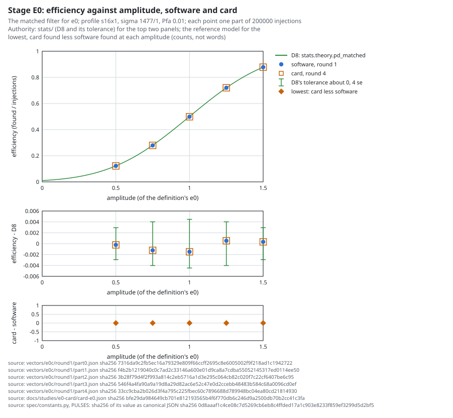
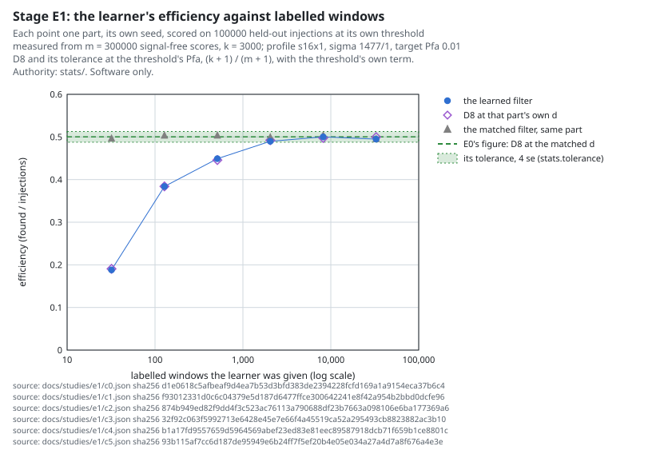
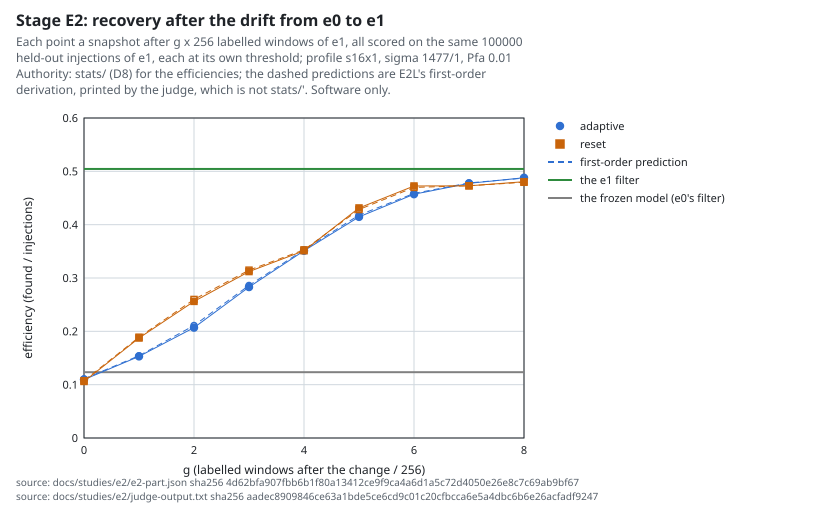
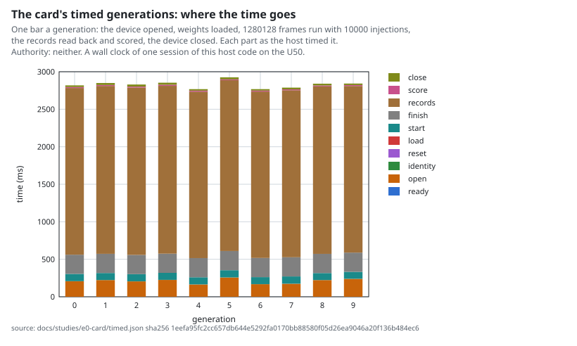
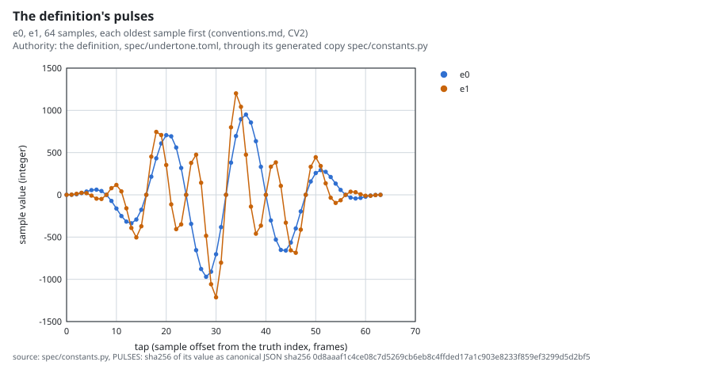

# Figures made from the project's records

The figures here are **generated copies of committed records**, as `spec/`'s three copies are of the definition. `python -m viz` makes every one of them from the records in the tree and writes this folder; no figure here is drawn by hand. Every number a figure shows is read from a committed record when it is made, or is the statistics package's formula (`stats/`, the second authority) evaluated at parameters read from a record. The generator types no number that a record holds.

**What holds that:** `tests/test_viz_figures.py` makes every figure again and requires the committed file byte for byte, so a record changed without its figure, or a figure edited by hand, fails the gate's first size. The same file reads each figure back and compares every value it carries with the record, read there independently. `tests/test_viz_writer.py` holds the writer, the refusals, the command, the imports and the colours.

    python -m viz            # write every figure into docs/figures/
    python -m viz --check    # write nothing; name each stale figure, exit 1 if any

The generator is `viz/`: the standard library, and `stats/` for a theory curve. It imports nothing of `model/`, `learn/`, `host/` or `rtl/`, and installs nothing. Each figure names on its last lines every file it read, with the SHA-256 of that file's bytes.

**A rerun of a record a figure reads needs `python -m viz` in the same commit.** That is the point of a generated copy (the lead's ruling, 2026-11-25).

## The figures

### Stage E0: efficiency against amplitude, software and card

- **Shows,** in three panels on one amplitude axis:
  - the efficiency, found over injections, at each amplitude, for round 1's software parts and the card's, with D8's curve;
  - each efficiency less D8's figure for that part (its own `expected`), with D8's tolerance about zero, four standard errors at a threshold known from sigma (`stats.tolerance.tolerance(pfa, d, n)`);
  - the card's count less the software's at each amplitude. **The card and software counts are equal, and this panel draws that as a row of zeros** rather than one marker hidden under another.
- **Reads:** `vectors/e0c/round1/part*.json`; `docs/studies/e0-card/card-e0.json`; `spec/constants.py`, `PULSES`, for `e0`.
- **The theory's parameters are the records':** each part's `d`, `pfa` and `expected`. A test holds `stats.theory.pd_matched(pfa, d)` equal to each part's own `expected`, exactly, for round 1's five and the card's five. The curve between the amplitudes is `pd_matched(pfa, d(a))`, with `d(a) = stats.theory.deflection(e0, a e0, sigma)`, the parts' own sigma and `e0` from the definition, every hundredth of an amplitude.
- **Authority:** `stats/` (D8 and its tolerance) for the top two panels. The reference model for the lowest: the card's records are the model's, so its counts are round 1's.
- **Does not show:** the words of the records (`compare-output.txt` holds that every record of every piece is the model's); the noise counts, the flags, the late reads or the flip control; anything about sensitivity that round 1 did not already show.

### Stage E1: the learner's efficiency against labelled windows

- **Shows:** each part's learned filter, found over injections, against the labelled windows it was given, on a log axis; that part's own D8 figure for the coefficients it learned; the matched filter on the same part's held-out stream; and E0's figure, D8 at the matched filter's `d`, with its tolerance as a band.
- **Reads:** `docs/studies/e1/c*.json`.
- **The theory's parameters are the records':** `d_learned`, `d_matched`, `n`, `m` and `k`. **The false-alarm rate is the measured threshold's, `(k + 1) / (m + 1)`**, as E1's judge hands it to D8 and the tolerance (`stats.recovery.threshold_from_scores`, its `pfa_effective`), not the record's target `pfa`. A test holds the figure's D8 figures, rounded, to the judge's printed ones; at the target rate E0's figure would be 0.5002, not the judge's 0.5003 (the lead's ruling, 2026-11-25 17:54).
- **Authority:** `stats/`. Software only.
- **Does not show:** the paired cost, the reported model's verdict, or where the curve enters the tolerance (`docs/studies/E1-software.md`, limit 3). One seed a part.

### Stage E2: recovery after the drift from `e0` to `e1`

- **Shows:** the adaptive and the reset models' efficiency at each snapshot g; the frozen model and the `e1` filter as lines; and each learner's first-order prediction, dashed, placed at the frozen model's efficiency plus the predicted gain.
- **Reads:** `docs/studies/e2/e2-part.json`, and `docs/studies/e2/judge-output.txt` for the predictions and the windows a step of g, which the part does not hold. A line of the judge's output not in the shape read is refused, `VIZ-PARSE`, and a snapshot whose printed count is not the part's, `VIZ-RECORD-PAIR`.
- **Authority:** `stats/` (D8) for the efficiencies. **The dashed predictions are E2L's first-order derivation, which is not `stats/`'**, printed by the judge to five decimals.
- **Does not show:** the gains' standard errors, or the paired comparisons. The nine points of a curve share one held-out stretch, so their errors are correlated (`docs/studies/E2-software.md`, limit 6).

### The card's timed generations

- **Shows:** one stacked bar a generation, each part of `parts_ns` as the host timed it, in the record's order from the bottom; a bar's top is the generation's `sum_ns`, which the generator requires its parts to add to.
- **Reads:** `docs/studies/e0-card/timed.json`.
- **Authority:** neither. A wall clock of one session of this host code (`docs/studies/CARD-e0.md`, limit 5).
- **Does not show:** the generations' counts or their identity with the model (`timed-judge-output.txt`), or `kept_ns` and `trace_ns`. A part shorter than about a pixel's worth of the axis is drawn but cannot be seen; the legend still names it.

### The definition's pulses

- **Shows:** each pulse of `PULSES`, its integers against the tap, oldest sample first (`docs/model/conventions.md`, CV2).
- **Reads:** `spec/constants.py`, the value of its `PULSES` assignment. **Its source line hashes that value as canonical JSON** (sorted keys, no spaces), not the file's bytes, so a change to the definition elsewhere does not make this figure stale and a change to a pulse does (the lead's ruling, 2026-11-25 17:44).
- **Authority:** the definition.

## How the figures are written

- **The writer** is `viz/svg.py`: panels, linear, log and category axes with ticks from a nice-number rule in `decimal`, polylines, markers, error bars, a band, reference lines, bars, a legend, title and source lines. It does not smooth, fit or clip: a value outside its axis is refused, `VIZ-AXIS-RANGE`.
- **Determinism.** No time, no random, no environment and no absolute path reaches a figure. Coordinates are written to the hundredth of a pixel by `"%.2f"`, never as `-0.00`; attributes are sorted; text is printable ASCII or refused, `VIZ-NOT-ASCII`; LF line ends and one final newline. Each value drawn from a record also sits on its element exactly: an int as written, a count ratio as the record's own two integers, a record's float as Python's `repr`.
- **Order.** What a figure draws is in the generator's order, not the file's: parts by their number, E0's card parts paired with round 1's by amplitude, E2's snapshots by g, the timed generations by number, the pulses by name. The same records in another order make the same figure.
- **Light and dark.** An opaque background, the theme's colours as attributes in the light set, and a `prefers-color-scheme: dark` rule that overrides them. Each series colour is one for both themes, and a test holds it at a contrast of at least 3:1 against both backgrounds by WCAG's ratio, and the text at 4.5:1.
- **Refusals,** each a `viz.errors.VizRefusal` with one of seven declared names: `VIZ-RECORD-MISSING`, `VIZ-RECORD-FIELD`, `VIZ-RECORD-PAIR`, `VIZ-PARSE`, `VIZ-AXIS-RANGE`, `VIZ-NOT-ASCII`, `VIZ-UNKNOWN-FIGURE`. `python -m viz` prints `REFUSED <name>: <detail>` and exits 2, and writes nothing when this folder holds an .svg the registry does not make.

## Adding a figure

1. Write a function in `viz/figures.py` that takes a `viz.records.Reader` and returns `Figure(...).render(...)`. Read every number through the reader (`r.json`, `r.text`, `r.glob`, `r.pulses`) and every field through `viz.records.field`, so a missing or mistyped field is refused by name and the file is named on the figure. Pass the reader's log to `fig.source`.
2. Add a line to `FIGURES` in the same file, and run `python -m viz`.
3. In `tests/test_viz_figures.py`, add the file name to `NAMES`, and a `*_findings` function that reads the record with `json` and checks each value and position, as the others do.
4. Add a section here: what it shows, what it reads, its authority, what it does not show. Commit the figure with the record it reads.

## Limits

1. **A figure that types the record's present value passes every test today.** The numbers test reads the record independently and compares values, so it sees a typed number only once the record and the typed number differ. That is why the third control changes the record in a copy first. The byte test cannot see it at all: it compares the figure with the same generator's output.
2. **The numbers test checks what the figure carries, not all it draws.** It checks every marker's, reference line's, band's, bar's and curve's value and position, and the source lines. It does not check the tick labels, the axis and legend words, which colour a legend gives a series, the error bars' drawn ends (their values are checked), or the subtitles' figures (profile, sigma, Pfa, counts). The byte test holds all of these to the generator, not to the record.
3. **Byte identity is held on this desktop's Python.** The theory curves are floating point. On another platform a last-bit difference in `math.erfc` could move a rounded coordinate by a hundredth of a pixel and fail the byte test there (BELIEVED, not tried).
4. **`stats/`' code is not hashed.** A change to `stats/` that changes a curve's values fails the byte test; one that does not, does not.
5. **E0's curve is D8 for the unrounded pulse `a e0`;** each part's own point uses its record's `d`, of the samples injected after rounding. At amplitude 1/2 the two `d` share their first six significant digits and differ in the seventh, which no figure can show.
6. **A figure reads the records its function names,** by fixed paths and by file-name patterns (`part*.json`, `c*.json`). A record elsewhere appears only when the generator is taught it.
7. **Colour.** The contrast test computes WCAG's ratio for the declared colours. It does not test a viewer's rendering, nor whether every reader can tell two colours apart: in E0, E1 and E2 the series differ by marker shape or dash as well, but the ten parts of the timed bars and the pulses differ by colour and legend order alone.
8. **Text widths are estimated,** 0.6 of the font size a character, and the font is the viewer's sans-serif. A wider font can make a label overlap its neighbour.
9. **Dark mode rests on the viewer** honouring `prefers-color-scheme` inside an SVG shown as an image. One that does not shows the light set on its own white background (BELIEVED for GitHub's viewer; not tried).
10. **The figures are no new evidence.** Each shows what its record already says. A bit-identity pass is not evidence about sensitivity, nor a sensitivity curve about the fabric (D0, section 2): each figure names the authority it rests on.

## Register

| # | claim | basis | source or command | falsified by |
|---|---|---|---|---|
| V1 | The five figures in this folder are what `python -m viz` makes from the committed records, byte for byte, and the folder holds no other .svg | MEASURED | `python -m pytest tests/test_viz_figures.py -k "committed_figure or folder_holds or registry"` | a figure or a record changed alone |
| V2 | Every value a figure carries from a record equals the record's, read independently; every marker, reference line, band, bar and curve point is drawn within 0.006 px of the test's own map of it (a bar's or the band's lower edge, the sum of two rounded figures, within 0.012 px); every source line names the file read and its SHA-256 | MEASURED | `python -m pytest tests/test_viz_figures.py -k shows_the_records_numbers` | that test |
| V3 | `stats.theory.pd_matched(pfa, d)` equals `expected` exactly in all ten E0 parts, round 1's five and the card's five | MEASURED | `test_viz_e0_d8_is_each_parts_own_expected` | that test |
| V4 | E0's tolerance bars are the card judge's: 0.00293, 0.00402, 0.00447, 0.00402, 0.00293 | MEASURED | `test_viz_e0_tolerances_are_the_card_judges`, against `docs/studies/e0-card/compare-output.txt` | that test |
| V5 | At `(k + 1) / (m + 1)` E1's D8 figures round to the judge's: own 0.1907, 0.3840, 0.4458, 0.4923, 0.4976, 0.4997; E0's 0.5003; the tolerance 0.01258. At the target `pfa` E0's figure rounds to 0.5002 | MEASURED | `test_viz_e1_theory_figures_are_the_judges`; `test_viz_e1_record_pfa_alone_would_not_give_the_judges_figure` | those tests |
| V6 | Each snapshot line E2's judge printed carries the part's count, and the gain it printed is (found less the frozen model's found) over n, to five decimals | MEASURED | `test_viz_e2_judge_output_is_this_parts` | that test |
| V7 | Each timed generation's parts add to its `sum_ns` | MEASURED | `test_viz_timed_bars_add_to_each_generations_sum` | that test |
| V8 | At amplitude 1/2 the part's `d` and `deflection(e0, a e0, sigma)` share their first six significant digits and differ in the seventh | MEASURED | `test_viz_e0_curve_d_and_the_parts_d_differ_in_the_seventh_figure` | that test |
| V9 | The brief's four named controls each fail as named: a figure edited by hand (a value, and a coordinate); a record changed by one count; a generator typing a count, on a record changed in a copy; a CR byte and a personal path refused by `eol` and `paths` on a copy | MEASURED | `python -m pytest tests/test_viz_figures.py -k control` | those tests |
| V10 | An import of `model`, `learn`, `host`, `rtl` or another package planted in a copy of `viz/` is caught, and a build loads none of the four | MEASURED | `python -m pytest tests/test_viz_writer.py -k import` | those tests |
| V11 | Every series colour has a contrast of at least 3:1 against both backgrounds, and the text at least 4.5:1; no figure uses another colour | MEASURED | `python -m pytest tests/test_viz_writer.py -k colour` | those tests |
| V12 | Seven refusal names, each raised by a case with that fault alone | MEASURED | `python -m pytest tests/test_viz_writer.py -k refus` | those tests |
| V13 | Coordinates to the hundredth of a pixel; the D8 curve every hundredth of an amplitude | DECISION | `viz/svg.py`, `fmt`; `viz/figures.py`, `CURVE_STEP` | those lines |
| V14 | The pulses' source line hashes `PULSES`' value as canonical JSON; E2's predictions are read from the judge's output; no registry row | DECISION | the lead's ruling, 2026-11-25 17:44, in the round's ledger | the ledger |
| V15 | Byte identity holds on another platform | BELIEVED | limit 3 | a build on another platform |
| V16 | The card's count equals round 1's at all five amplitudes, so E0's lowest panel is a row of zeros | MEASURED | `test_viz_e0_card_counts_equal_softwares` | that test |
| V17 | The same records in another order make the same figure: the timed generations, E2's entries, the card's parts and the pulses, each reversed | MEASURED | `python -m pytest tests/test_viz_writer.py -k does_not_depend_on_the_records_order` | that test |
